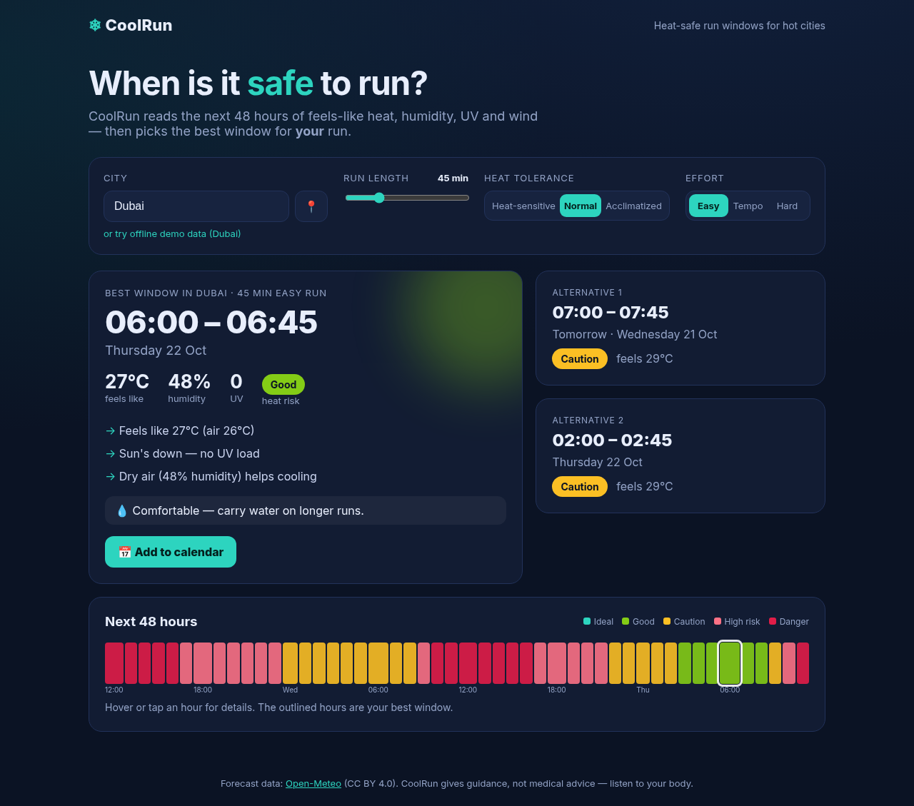

# ❄︎ CoolRun

**Find the safest time to run in the next 48 hours — when you live somewhere hot.**

Weather apps show numbers; CoolRun answers the question runners in places like Dubai actually have: *when should I go?* It scores every hour of the forecast for heat risk — feels-like temperature, sun (UV), humidity, breeze — adjusted for **your** run length, effort and heat tolerance, then recommends the best window, explains why, and adds it to your calendar.



## Features
- City search (or "use my location") with live forecasts from [Open-Meteo](https://open-meteo.com/) — free, **no API key**.
- Best run window + two alternatives ≥3 h apart, with risk band (Ideal → Danger) and plain-English reasons.
- 48-hour heat ribbon; hover any hour for details.
- Instant re-planning when you change run length (20–120 min), effort, or heat tolerance.
- One-tap `.ics` calendar export with a 30-minute reminder.
- Offline demo data (Dubai) so it always works.

## Run it
Requires Node.js 18+. No dependencies to install.
```bash
node server.mjs
# open http://localhost:5173
```
(Any static server pointed at `app/` also works, e.g. `python3 -m http.server -d app`.)

Tests: `node --test test/`

## How the score works
`effective = feels-like + 0.6×UV (daytime) + 0.08×(humidity−60) − 0.08×wind(≤30 km/h) + effort(0/1.5/3) − tolerance(−2/0/+2)`
Bands: <24 °C Ideal · <28 Good · <32 Caution · <36 High risk · ≥36 Danger. A window's risk is its worst hour; best = lowest risk, soonest first.
These are heuristic guidance thresholds — **not medical advice**.

## Project layout
```
app/        the web app (index.html, styles.css, main.js, api.js, scoring.js, ui.js, ics.js, sample-dubai.json)
test/       node:test unit tests for the scoring logic
server.mjs  zero-dependency static server
video/      headless Playwright script used to record the demo
devpost/    planning docs from the Devpost Learn skill pack: scope.md, prd.md, spec.md, checklist.md
```

## Built with
Plain HTML/CSS/JavaScript, Open-Meteo APIs, Node.js. Planned and built with the [Devpost Learn skill pack](https://github.com/challengepost/learn-ai-basics) and an AI coding agent.

Weather data by [Open-Meteo.com](https://open-meteo.com/) (CC BY 4.0). License: MIT.
